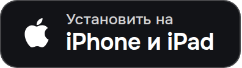

<p align="center">
  
</p>

<h1 align="center">olcOS для Android</h1>

<p align="center">
  Исходный код приложения olcOS для Android 8.0+ (Kotlin, Jetpack Compose).<br>
  olcOS помогает обойти белые списки мобильного интернета через видеозвонки.
</p>

> [!IMPORTANT]
> **Хотите просто установить приложение?** Здесь лежит исходный код. Скачайте готовый файл по кнопке ниже, а
> пошаговая инструкция есть в [главном репозитории olcOS](https://github.com/olcOS/olcos#android) и на
> [сайте](https://olcos.github.io/#download).

<p align="center">
  <a href="https://github.com/olcOS/olcos/releases/download/v3.0.3-beta/olcOS-3.0.3-beta-android.apk"></a>&nbsp;
  <a href="https://github.com/olcOS/olcos#iphone-и-ipad"></a>
</p>

<p align="center">
  <a href="https://olcos.github.io">Сайт</a> ·
  <a href="https://github.com/olcOS/olcos">Инструкция</a> ·
  <a href="https://github.com/olcOS/olcos#если-не-работает">Если не работает</a> ·
  <a href="https://github.com/olcOS/olcos-ios">iOS</a> ·
  <a href="README.en.md">English</a>
</p>

## Что это

olcOS ведёт трафик телефона через ваш собственный сервер. Данные идут внутри обычного видеозвонка: в VK Звонках,
Яндекс Телемосте, SaluteJazz, МТС Линк или Jitsi. Когда мобильный интернет работает по белому списку, обычный VPN не
может достучаться до своего сервера, а звонки VK и Яндекса оператор обычно пропускает. Если белых списков нет, к
серверу можно подключиться и напрямую по Xray (VLESS + REALITY).

Как работают белые списки, как установить приложение и поставить сервер, рассказано в
[главном репозитории](https://github.com/olcOS/olcos).

## Возможности

- VPN для всего телефона или SOCKS5-прокси на `127.0.0.1` для приложений, которые умеют с ним работать.
- Подключение по ссылке, QR-коду, подписке или приглашению с другого устройства. Ссылку можно вставить на вкладке
  «Подключения» или открыть из другого приложения.
- Несколько комнат на одном сервере склеиваются в один канал. Если комната отвалится, приложение подключит её снова.
- Установка своего сервера по SSH прямо из приложения: «Подключения» → «+» → «Свой сервер (VPS)».
- Управление сервером: статус, запуск и остановка комнат, журналы, новые протоколы, смена ключа и приглашения для
  других устройств.
- Комнаты Телемоста, VK Звонков и SaluteJazz создаются с телефона. Для МТС Линк нужна постоянная встреча из вашего
  аккаунта.
- Обновления через [Obtainium](https://apps.obtainium.imranr.dev/redirect?r=obtainium://app/%7B%22id%22%3A%22io.olcos.app%22%2C%22url%22%3A%22https%3A%2F%2Fgithub.com%2FolcOS%2Folcos%22%2C%22author%22%3A%22olcOS%22%2C%22name%22%3A%22olcOS%22%7D):
  он следит за релизами на GitHub и предлагает новую версию.
- Интерфейс на русском и английском.

## Сборка

Нужны JDK 17, Android SDK с NDK и Go (версия указана в `olcos-core/mobile/go.mod`). Ядро на Go и серверная часть
лежат в репозитории [olcOS/olcos-core](https://github.com/olcOS/olcos-core), он подключён подмодулем `olcos-core/`:

```bash
git clone --recurse-submodules https://github.com/olcOS/olcos-android.git
cd olcos-android
bash scripts/build-core.sh          # ядро -> app/libs/olcoscore.aar
bash scripts/sync-core-assets.sh    # srv.sh, патч ядра и исходники агента -> assets
gradle assembleDebug
```

Как устроено приложение, как CI собирает ядро и APK и какие форматы ссылок поддерживаются, описано в
[docs/development.md](docs/development.md).

## Ошибки и безопасность

Ошибки и вопросы пишите в [Issues главного репозитория](https://github.com/olcOS/olcos/issues/new/choose) и укажите,
что речь об Android, а также версию приложения и системы. Журнал можно скопировать в приложении: Настройки →
«Диагностика» → «Скопировать журнал». Уберите из него ключи, пароли и полные ссылки. Об уязвимостях сообщайте
приватно, как описано в [SECURITY.md](https://github.com/olcOS/olcos-ios/blob/main/SECURITY.md).

Пользуйтесь приложением в рамках закона своей страны и правил сервисов, через которые идёт трафик.

## Лицензия

olcOS распространяется под лицензией [MIT](LICENSE). Туннель построен на
[olcrtc](https://github.com/ghostlane-project/olcrtc) (Apache-2.0), прямой режим использует
[Xray-core](https://github.com/XTLS/Xray-core) (MPL-2.0).
